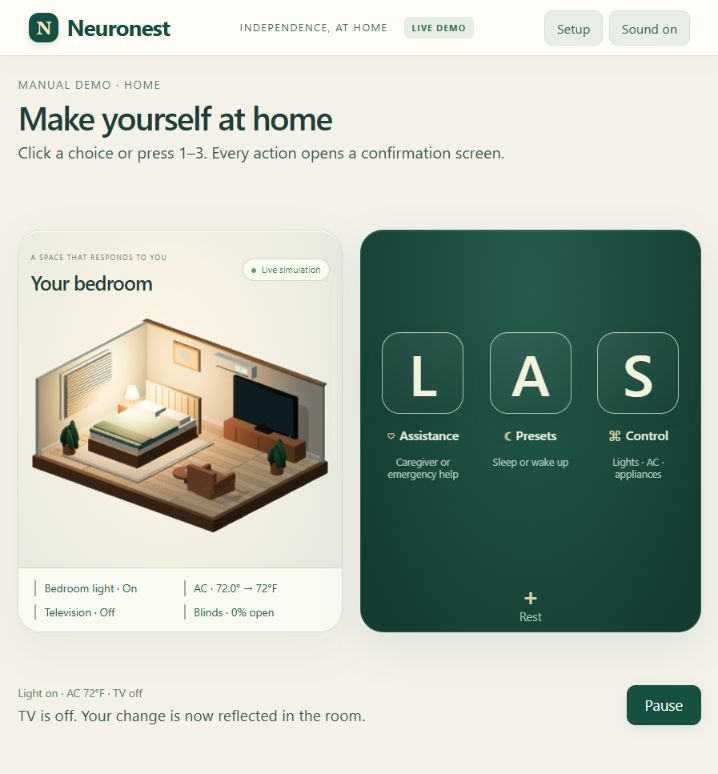

# Neuronest

**Your room. Your choice.** Neuronest is an accessible smart-room prototype that explores how people with limited mobility can control their surroundings through EEG-based selection. Built for a hackathon, it pairs the Unicorn Hybrid Black headset with a live 3D bedroom and a simple, three-choice interface.

Instead of navigating long menus, the wearer attends to one of three fixed letter targets and counts the faces that briefly appear on it. The app uses calibrated event-related EEG responses to select an option, then asks for a separate confirmation before applying a simulated command. It also includes a manual mode for presentations and UI testing without a headset.



## What it does

- **Control the room:** switch lights and TV on or off, adjust the AC target, and raise or lower blinds.
- **Apply daily presets:** prepare the room for sleep or waking up with one confirmed action.
- **Request assistance:** demonstrate caregiver and emergency-help flows with clear request status.
- **See every change:** a furnished 3D bedroom reflects lighting, TV power, blinds and cooling, with animated command receipts and spoken feedback.
- **Keep navigation accessible:** three choices at a time, a fixed page without scrolling, explicit confirmation, and a rest option that makes no selection.
- **Present resilience scenarios:** simulate a hurricane, power outage or lost internet through presenter tools.

All room devices and assistance requests are local simulations. Neuronest does not contact emergency services or control physical devices. It is an experimental hackathon prototype, not a clinically validated assistive device. Its visual face-selection method requires attending to the screen; it does not decode arbitrary thoughts.

## Built with

TypeScript, Vite and Three.js provide the interface and 3D room. A local Python service handles Unicorn acquisition, EEG processing, calibration and simulated device commands. The active selection method uses face-based event-related potentials with a calibrated shrinkage LDA classifier; earlier alpha and frequency experiments remain in the source for reference.

## Launch

1. Close the previous local server window so the updated reader can start.
2. Open **Start Neuronest.cmd**. This starts real Unicorn acquisition with the same 2,400 µV experimental cue-screening limit used in the passing face test.
3. Keep the app in the foreground. Choose **Start calibration**, or use **Setup → Load passing results** to restore your saved `homeway-face-results.json` or `neuronest-face-results.json` from the same wearer and unchanged headset fit. After loading, choose **Use headset**.
4. A successful fresh calibration automatically opens the home controls. The letters L, A and S remain fixed. Count only faces on the letter above your desired option; look at + to make no selection.
5. **Pause** or Escape stops selection and cancels pending actions. Resume starts from Home with a completely new round.

**Start Unicorn.cmd** is an alias for the new live launcher. **Start Picture Test.cmd** also opens the integrated app with the same acquisition settings. **Start Demo.cmd** starts without EEG; choose **Setup → Manual demo** for click or keyboard control. Node.js 22.18+ and 64-bit Python 3.12 are required; **Setup.cmd** installs dependencies on a new computer.

The default address is http://127.0.0.1:8766. Keep the launcher window open. Rebuild and refresh after frontend changes; restart the launcher after reader changes. A passing result applies to the fitted wearer and session, and does not establish performance after moving the headset or changing wearers.

## Three choices on every menu

| Menu | L | A | S |
| --- | --- | --- | --- |
| Home | Assistance | Presets | Control |
| Assistance | Caregiver | Emergency | Home |
| Presets | Sleep | Wake up | Home |
| Control | Lights | AC | Appliances |
| Appliances | TV | Blinds | Home |
| Lights | On | Off | Home |
| AC | Cooler | Warmer | Home |
| TV | On | Off | Home |
| Blinds | Up | Down | Home |
| Confirmation | Incorrect · Home | Confirm | Wait |

Sleep turns the bedroom light and TV off, closes the bedroom blinds, and sets the AC target to 72°F. Wake up turns the light on, opens the blinds, and sets the AC target to 74°F. These presets do not change the door lock or bed. AC controls adjust the target by one degree within 60–85°F; Warmer reduces cooling rather than activating heating.

An action is prepared first and applied only after a fresh face-selection round chooses Confirm. Rest or uncertain EEG produces no selection. Wait leaves the action pending. Live confirmation expires after 90 seconds, allowing a full new ERP round and a retry; manual confirmation expires after 30 seconds. Pause, lost focus, disconnected EEG, and changed home conditions invalidate pending actions. The backend checks session, screen, freshness, expiry and changed home conditions before applying commands.

The resident interface occupies one viewport. All three face targets remain on the same board during calibration and home control. Device and request status appear below. Setup and presenter controls are assisted controls in dialogs, outside the resident's three-choice flow.

## Presentation room and command feedback

The main preview is now a dedicated, furnished bedroom with an upholstered bed, bedside lamp, reading nook, large television, window blinds and AC. The cutaway camera focuses on the room. Lighting, daylight through the blinds, the TV screen and cooling airflow reflect the simulated state. Shadowed furniture, warm wood, cream surfaces and deep green controls form the presentation design. Security has been removed from the resident menus and room status.

After the server accepts a confirmed command, an animated result card appears over the choice board while the bedroom remains visible. It includes the result title, a short description, spoken feedback and a countdown. It dismisses itself after 4.5 seconds; Continue can dismiss it earlier in manual testing. Another command cannot be selected until it closes. The EEG loop waits for the card before starting a new face round. Escape, Pause or losing focus also dismisses it.

Success, partial preset results and offline assistance failures have different titles and colors. Moving blinds report that the motion has started, rather than claiming they have already reached their destination. A rejected or canceled action never gets a success card. Sleep also switches the TV off. TV is unavailable during the simulated grid outage.

The room and all three targets fit within one viewport, side by side on wide screens and stacked on narrow screens. The scene redraws when its state or size changes, without a permanent animation loop competing with EEG cues. Displays without WebGL keep the controls and text state. The face decoder and cue timings are unchanged.

Restart the local launcher after updating, because the backend now includes the television and structured command results. Refreshing alone cannot update an already-running Python reader.

## Local simulation

All devices, locks, assistance requests, and hurricane alerts are simulated. No real calls, emergency dispatch, messages, or hardware commands leave the computer. The fictional resident is Alex Morgan at 100 Demo Lane, Tampa.

**Setup → Presenter tools** can toggle a simulated hurricane, grid outage, and internet loss, reset the home, acknowledge or resolve an assistance request, and retry a failed request after restoring the simulated connection. Loss of grid power disables AC and blinds while backup lights and locks remain available. Offline assistance requests fail until explicitly retried. The home state resets when the local server restarts.

Spoken prompts and menu choices are bundled WAV files. Sound can be toggled in the header. The app waits for instructions to finish and leaves an 800 ms quiet interval before EEG cues. The shared prior sound preference is retained.

## Face selection and calibration

The unchanged decoder uses 160 ms faces with a 700 ms minimum onset interval. Each round has 24 cues, eight per letter, with shuffled triplets and no adjacent repeats. The guided practice uses four appearances per letter. Twelve training rounds precede eight independent test rounds, taking approximately eight minutes. All six accepted target choices and both rest trials must pass before live home control opens.

The reader collects five scans per block, detects sample-counter discontinuities, continuously filters EEG at 0.5–15 Hz, and extracts a 200 ms baseline plus six 100 ms means spanning 100–700 ms after the marker. Full-covariance LDA with fixed 20% shrinkage uses all channels that remain usable through training; at least two channels including Cz or Pz are required. Whole rounds are held out for calibration. Rest rejection and letter ranking are reported separately, and independent test labels never enter fitting.

The same `cueSequence`, `collectRound`, marker endpoints, feature extraction, and frozen `predict` model run home selection. Every new menu starts a new round. Faces, EEG features and results are never fabricated to make a live selection. Browser/host timing still has unmeasured Bluetooth and display latency.

**Save results** downloads training and validation features, scores, model, and timing diagnostics locally. Loading a results file refits only its training rounds and checks its eight independent validation rounds again; a claimed pass flag or arbitrary saved weights cannot bypass that check. Nothing is uploaded. No EEG profile is silently persisted across wearers.

The original alpha and frequency prototypes remain in source for reference, but the app entry now opens the face-controlled Neuronest interface. The installed independent g.tec Unicorn SDK is used directly, avoiding the gpype attestation import. No Windows security policies or vendor libraries are modified.

## Verification

```powershell
npm.cmd test
.\.venv\Scripts\python.exe -m unittest discover -s headset -p 'test_*.py'
npm.cmd run build
```

Tests cover synthetic ERP separation, noise and rest, event timing, continuous filtering, dropped samples, three-choice navigation, separate confirmation, cancellation during in-flight requests, profile revalidation, and simulated-device behavior. These tests verify software behavior; the wearer must verify live control.

## References

- [Unicorn Speller interaction](https://www.youtube.com/watch?v=aB60zmmTLq0).
- [Pontifex's Unicorn acquisition and event markers](https://github.com/mattpontifex/UnicornHybridBlack).
- [g.Pype oddball filtering and averages](https://github.com/gtec-neurotechnology/gpype/blob/main/examples/s5e4_oddball_paradigms.py).
- [Unicorn assistive application using its ERP SDK](https://github.com/AiRobo-UVT/EEG-headsets-application).
- [Shrinkage LDA research](https://pmc.ncbi.nlm.nih.gov/articles/PMC7765532/).
- Portrait from [Matplotlib's Grace Hopper sample](https://github.com/matplotlib/matplotlib/blob/v3.10.0/lib/matplotlib/mpl-data/sample_data/grace_hopper.jpg).
